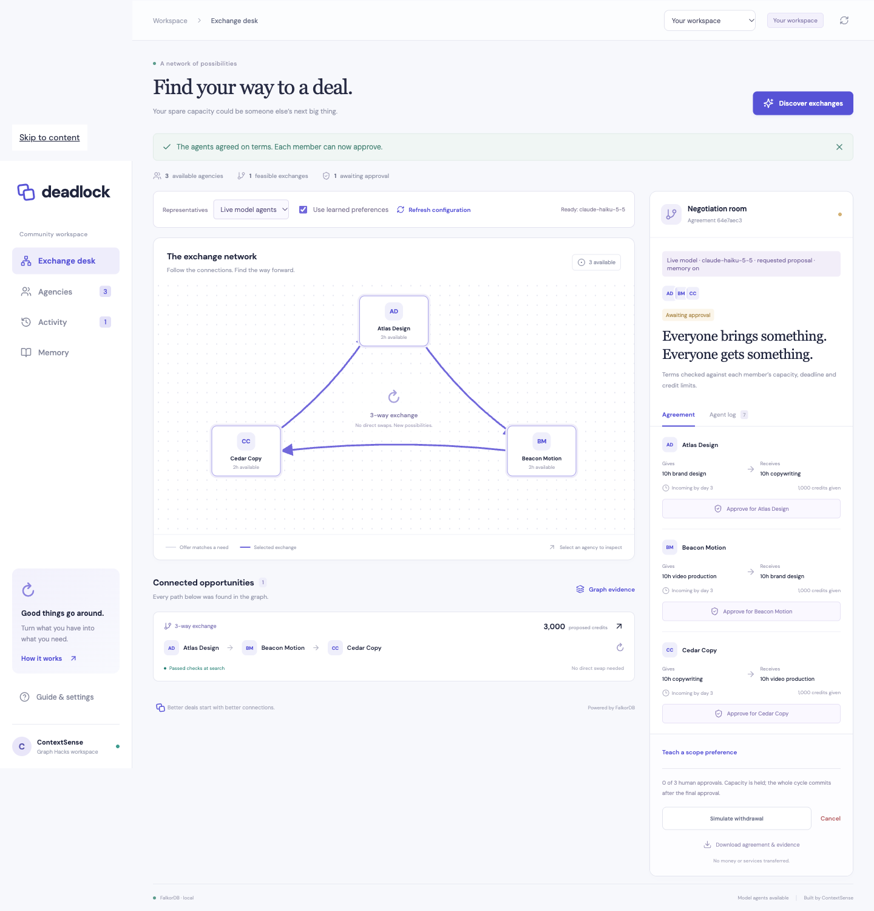
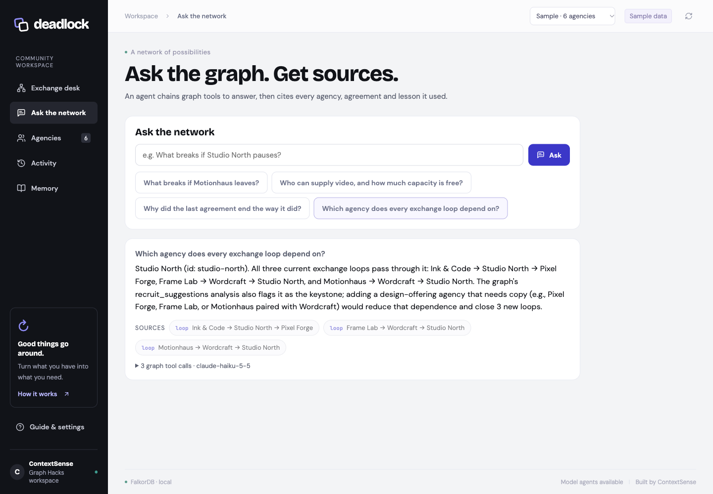
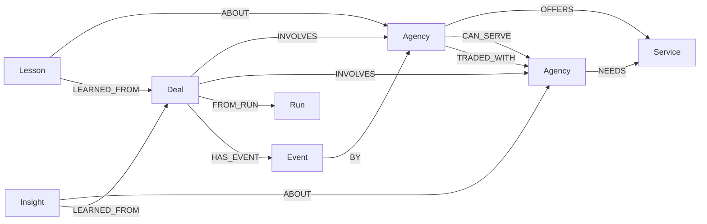
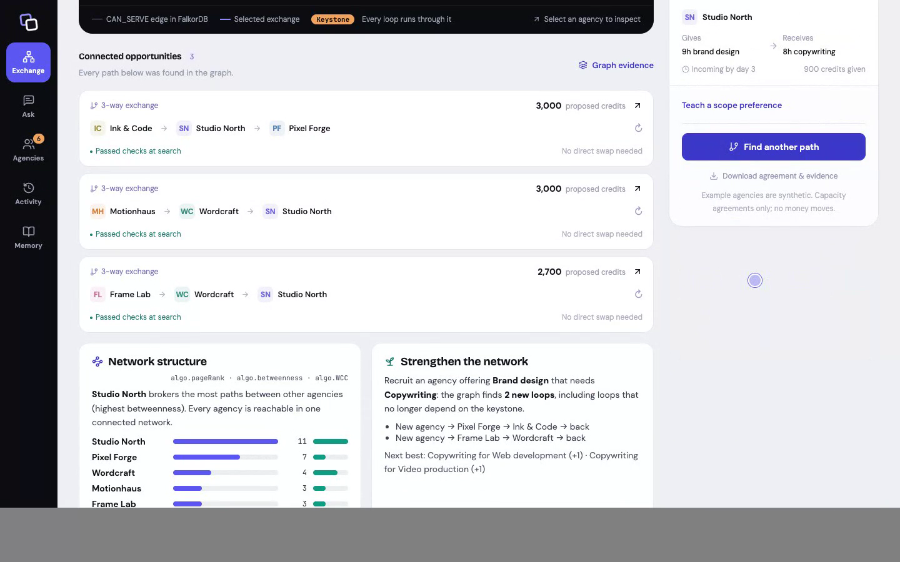

# Deadlock

**A connected deal where a direct swap cannot work.** Built by team **ContextSense** for Graph Hacks.

Deadlock lets fictional creative agencies exchange spare capacity in three- or four-party agreements. One agency's offer meets another's need; FalkorDB finds the cycle that closes the exchange. Live model representatives inspect graph context, accept, counter or reject validated proposals. A key-free policy simulation is also available. Humans approve each participant before the complete cycle commits.

Tracks: **Agents That Act on Connected Data**, **Agent Memory and Coordination** and **Company Brain**.

## What the graph does

| Capability | How FalkorDB does the work | Track |
|---|---|---|
| Find exchanges no pair can make | Variable-length cycle traversal over derived `CAN_SERVE` edges | 01 |
| **What breaks if an agency leaves** | The same traversal re-run with that agency excluded: broken loops, affected agreements, held hours, who is still routable, who is stranded | 01 |
| **Keystone agencies** | Agencies every current loop runs through, flagged on the network | 01 |
| **Who to recruit next** | 1–2 hop path query for each missing offer/need profile predicts how many new loops it would open (prediction verified by test) | 01 |
| Agents act on the graph | Representatives inspect graph context and accept, counter or reject validated proposals; capacity is held only after all agree | 01 |
| **Ask the network** | An agent chains seven fixed, parameterized Cypher tools and must cite the agency, deal, lesson or loop nodes it retrieved | 01 · 03 |
| **MCP server** | `npm run mcp` exposes the same graph tools plus discovery and negotiation to any MCP client | 01 |
| Memory that changes terms | Human-taught `Lesson` nodes (`ABOUT`, `LEARNED_FROM`) produce remembered proposals; ablation proves the change | 02 |
| **Memory that learns by itself** | Committed agreements write `TRADED_WITH` partner edges that lift proven loops; failed negotiations write `Insight` nodes that flag the loop until the blocking profile changes | 02 · 03 |
| Shared state across instances | Every write is a compare-and-swap on the graph's workspace revision | 02 |
| Decisions traced to source | Every decision is an `Event` node linked to its agreement and agency; `explain_deal` walks it | 03 |

[Public source](https://github.com/MaanavKrishna/deadlock-graphhacks) · [Three-minute narrated video](https://github.com/MaanavKrishna/deadlock-graphhacks/releases/download/v0.2.0/deadlock-live-demo.mp4) · [Release and downloads](https://github.com/MaanavKrishna/deadlock-graphhacks/releases/tag/v0.2.0)





## Run locally

Requirements: Node.js **22.12 or later** and npm. Native embedded operation supports **macOS Apple Silicon** and **Linux x64**. Other platforms can connect to a Docker/cloud FalkorDB instance. A Claude API key enables live representatives. Policy simulation runs without a key.

On macOS, the bundled FalkorDB module links Homebrew's OpenMP and OpenSSL libraries. Install them first if missing: `brew install libomp openssl@3`. `npm run doctor` checks that the engine can actually load and answer a query.

```sh
npm ci
npm run doctor
npm run dev
```

Open **http://127.0.0.1:3000** for the landing page, **/app** for the workspace and **/docs** for the documentation. The server starts a real local FalkorDB process and seeds six synthetic agencies on first use. Persistent graph files live in `.data/graph`. Stop with Ctrl+C. Start again to resume the same agreements and history.

The root optional dependencies pin the corrected platform binary release. Do not remove them: an older upstream macOS package contains Linux executables. If npm omits optional dependencies, run `npm ci --include=optional`. `npm run doctor` verifies an actual Cypher query against the native engine.

For production serving on your own machine:

```sh
npm run build
npm start
```

The local API binds to `127.0.0.1` by default. It is one shared workspace without per-user accounts. Set `ACCESS_KEY` to require a key for workspace replacement and paid model negotiations; discovery, policy negotiation, approvals and profile edits remain open so visitors can try the exchange.

### Hosted deployment (Vercel + FalkorDB Cloud)

`src/index.ts` exports the same Express API for Vercel's Node runtime, and Vite builds the frontend into `public/` for the CDN. Create a FalkorDB Cloud instance, import this repository in Vercel, and set these environment variables in the Vercel project (never in Git):

- `FALKORDB_URL` — the instance's `rediss://…` connection string (required)
- `ACCESS_KEY` — key for workspace replacement and model runs (strongly recommended)
- `MODEL_API_KEY`, `MODEL_NAME`, `MODEL_BASE_URL` — optional live model representatives

The first request seeds the starter network into the empty graph. Several function instances can serve traffic at once: every write is checked against the graph's workspace revision (below).

The embedded data directory is locked against a second application process. After an unclean shutdown, a stale `.data/graph/.deadlock.lock` may remain; remove that file only after confirming no Deadlock process is using the directory. Normal Ctrl+C shutdown releases the lock automatically. Frontend development uses polling so updates also work in cloud-synced folders. Restart the server after backend edits.

## Try the complete demo

1. Click **Discover exchanges**. Inspect the graph-generated opportunities and open **Graph evidence**.
2. Select the opportunity containing **Motionhaus**, **Wordcraft**, and **Studio North**.
3. Click **Start negotiation**. Open **Agent log** to inspect each representative's checks.
4. Before approving, click **Simulate withdrawal**. Motionhaus becomes unavailable; the old agreement is invalidated and every hold is released.
5. Click **Find another path**, select the **Frame Lab** cycle and negotiate. The agents counter to fit Frame Lab's eight-hour capacity.
6. Approve separately for each member. The final approval commits all capacity in one graph transaction.
7. Download the agreement and evidence. Reload; inspect **Activity**. Restart the server to verify durable memory.

Choose **Workspace setup → New empty workspace**, confirm replacement, and use **Agencies** to enter your own agency offers/needs and constraints. This workspace stays empty across restarts until you add profiles. Live model mode is selected on reload when configured. Sample networks remain separately labeled.

Use **Agencies** to create profiles or change hours, valuations, deadlines and availability. Use **Guide & settings → Reset demo workspace** for a fresh seeded network. Reset affects only the configured Deadlock graph.

## Why FalkorDB is essential

There is no in-memory matching fallback or hardcoded runtime cycle. Typed offers and needs derive directed compatibility edges **inside FalkorDB**. A Cypher variable-length path query discovers closed paths of three or four agencies. The result controls who can negotiate. Graph relationships also retrieve earlier agreements as context for representatives. Profiles, reservations, approvals, events, source-backed lessons and history persist in FalkorDB.

```cypher
MATCH p=(a:Agency)-[:CAN_SERVE*3..4]->(a)
WHERE all(n IN nodes(p) WHERE n.active = true)
RETURN [n IN nodes(p) | n.id] AS ids LIMIT 2000
```

The coordinator removes repeated participants, deduplicates rotations while preserving direction, and evaluates constraints. Removing FalkorDB stops both discovery and durable operation.

### Graph data model



- **Agency:** offer, need, capacity, held/committed hours, valuation, minimum/requested hours, deadlines, availability and revision.
- **Service:** exact shared taxonomy: design, video, copy, development.
- **Run:** actual discovery query, returned candidates, timestamp and duration.
- **Deal:** immutable participant/terms snapshot, lifecycle status, member approvals and negotiation events.
- **Event:** actor, round, actual tool/proposal, evidence IDs, public justification and timestamp.
- **Lesson:** explicit participant feedback, preferred scope, active/superseded state, source agreement and agency.
- **Insight:** written automatically when a negotiation fails: blocking agency, reason, source agreement and the agency revision it applies to.
- **TRADED_WITH:** written for every leg of a committed agreement; discovery ranks loops with proven partners higher.

Readable JSON properties preserve complete snapshots; explicit nodes and relationships power matching, memory and provenance. See [all queries](docs/QUERIES.cypher) and [architecture](docs/ARCHITECTURE.md).

## Agents and agreement guarantees

The default representatives are **deterministic policy agents**, not language models. Each has independent capacity, delivery and value limits. In at most six rounds they inspect, counter, accept or reject an exchange. They never silently relax a member's minimum or deadline. Credits are synthetic comparison units, not currency.

A stable agreement holds capacity and enters `awaiting_approval`. Each participant requires an explicit human sandbox approval. Final approval converts all holds to commitments together. Duplicate approval is idempotent. Cancellation or a profile change releases every affected pending hold. Committed agreements remain historical records; the app does not claim any service was delivered.

Each mutation is one atomic Cypher write, serialized within a process. Across processes, the write is a **compare-and-swap on the `Workspace` node's revision inside FalkorDB**: the statement only applies if the revision is unchanged since the state was read, otherwise nothing is written and the API returns 409. Two instances racing for the same capacity cannot both hold it (covered by `tests/consistency.test.ts`). Each write replaces the small workspace snapshot, so write cost grows with history; it is sized for a community of tens of agencies, not an unbounded marketplace. There is no automatic reservation expiry, real identity verification, escrow or payment system.

### Live model representatives

Copy `.env.example` to `.env` and configure `MODEL_API_KEY`, `MODEL_NAME`, and optionally `MODEL_BASE_URL` for a Chat Completions-compatible provider that supports function tools. Select **Live model agents** in the exchange desk. Configuration is reread on each operation; **Refresh configuration** updates the UI without restarting. Keys stay on the server and `.env` is ignored by Git.

For **Claude Haiku 5.5** through Anthropic's compatibility endpoint:

```dotenv
MODEL_API_KEY=your-anthropic-api-key
MODEL_NAME=claude-haiku-5-5
MODEL_BASE_URL=https://api.anthropic.com/v1
```

The output budget is 2,048 tokens per request. No temperature or top-p override is sent. See [Anthropic compatibility documentation](https://platform.claude.com/docs/en/cli-sdks-libraries/libraries/openai-sdk) and [Haiku 5.5 model documentation](https://platform.claude.com/docs/en/models/haiku-5-5/overview).

Each representative must actually call `inspect_exchange` before choosing `accept_offer`, `counter_offer` or `reject_offer`. Its context contains the graph-discovered path, current participant constraints, feasible proposal menu, and its own active lessons. A counter replaces the entire proposal vector and clears all earlier representative acceptances. Every member must accept the new terms again. The server revalidates all hard limits before holding capacity. Models cannot approve for humans.

Decisions are bounded to three tool requests per representative turn, six negotiation rounds and a sixty-second overall budget. Each provider request has a twelve-second timeout. Errors, malformed tools, repeated counters and vetoes persist a rejected negotiation with zero new capacity holds. There is no silent policy fallback in model mode. Models choose among a small validated menu rather than invent arbitrary terms.

### Prove memory changes behavior

1. Use the **Starter** scenario and **Policy simulation**. Uncheck **Use learned preferences**, discover, then negotiate the Motionhaus / Wordcraft / Studio North cycle. Studio North receives **10h**.
2. Open **Teach a scope preference**, choose Studio North and remember **8h**. This is explicit sandbox participant feedback, not automatically inferred satisfaction.
3. Cancel the pending deal to release its holds. Enable learned preferences, discover the same cycle and negotiate again. Studio North's representative counters to the remembered **8h** scope; hard profiles stay unchanged.
4. Open **Memory**. The comparison links both recorded agreements and the lesson's source. It appears only when path, mode, known provider-reported model identity, profiles and available capacity match exactly.

Lessons persist across a database restart. Disabling memory restores the original requested terms. Infeasible preferences cannot override hard minimums, deadlines, credit balance or capacity. New feedback supersedes earlier feedback for the same agency.

### The launch challenge

Choose **Launch challenge · 10 agencies** and confirm the replacement. It includes unequal hourly valuations, constrained capacity, real four-party cycles through Shipyard and Signal Press, and Premiere's attractive but late delivery. The graph discovers Premiere's paths, but deadline checks reject them even when requested credit totals are higher. Scenario replacement clears existing agencies, lessons and history after confirmation.

### Ask the network and MCP

Open **Ask the network** and ask, for example, "What breaks if Motionhaus leaves?" or "Which agency does every loop depend on?". The agent may only call fixed graph tools (`list_agencies`, `find_providers`, `who_can_serve`, `find_loops`, `withdrawal_impact`, `agency_history`, `explain_deal`, `recruit_suggestions`); it never writes Cypher. Its answer can only cite node ids those tools returned, and the tool trace is shown under every answer. Requires a configured model; protected by `ACCESS_KEY` when set.

To use the graph from Claude Desktop, Claude Code or another MCP client while Deadlock runs:

```json
{
  "mcpServers": {
    "deadlock": {
      "command": "npx",
      "args": ["tsx", "src/mcp.ts"],
      "cwd": "/path/to/deadlock-graphhacks",
      "env": { "DEADLOCK_URL": "http://127.0.0.1:3000" }
    }
  }
}
```

The MCP server adds `discover_exchanges` and `negotiate_loop` (policy agents). It deliberately cannot approve agreements; that stays a human action in the app.

## Docker or an external database

If Docker is running, the complete app and database can be started with:

```sh
docker compose up --build
```

The app is available at http://127.0.0.1:3000. The named `graph-data` volume holds database data. The compose ports bind only to localhost. Do not run the native app on port 3000 at the same time. The Docker path is supplied for portability; this machine's Docker daemon was stopped, so the verified path is native embedded FalkorDB.

For an existing database, set `FALKORDB_URL=redis://127.0.0.1:6379` in `.env`. Use `rediss://` for a TLS endpoint and `FALKORDB_GRAPH` for an isolated graph name. External database persistence is the operator's responsibility. **Use a dedicated graph**: demo reset replaces the selected graph's contents.

## Checks

```sh
npm run typecheck
npm test
npm run build
npm audit
```

Tests start isolated real FalkorDB instances, so optional native binaries are required for the integration suite even when the app uses a remote database. Coverage includes policy counters and deadlines, graph cycle discovery, contention, human approval transitions, invalidation, cancellation, restart persistence, prior-context retrieval, API validation, real HTTP tool protocol, model-selected reservations, safe model failure, restart-persistent learned preferences and controlled memory ablation. Browser checks cover desktop/mobile negotiation, withdrawal, rerouting, approvals, profile editing/creation, and reload. See [browser QA](docs/BROWSER-QA.md) and [progress](docs/PROGRESS.md) for verification records.



## Verified live behavior

Claude Haiku 5.5 was tested through Anthropic's actual API. The baseline held 10h per participant. After explicit feedback preferring 8h, a live representative countered, every member accepted again, and the final proposal held 8h each. The Memory view links both outcomes under matching profiles, capacity and reported model identity. This is an observed model run, not a deterministic promise about future model choices.

Live testing also produced rejected negotiations. A repeated-inspection issue was fixed with phase-specific tool menus and a regression test; an unmotivated model veto was preserved without capacity holds. Counter tools exclude current/visited proposals, and are omitted when no alternatives remain. The model now receives explicit semantics for aspirational requests, hard minimums and agency-specific remembered preferences. The server enforces safety independently of those explanations.

A separate browser journey entered Atlas Design, Beacon Motion and Cedar Copy through the profile editor, discovered their graph cycle, and completed a live Haiku negotiation with 10h per participant held for approval. Custom workspace and export metadata correctly identify user-entered profiles.

The automated suite contains 45 tests, including withdrawal what-if traversal, keystone detection, recruitment predictions verified against real additions, self-learning partner edges and failure insights, the Ask agent's tool chaining and citation filtering over the real protocol, the MCP tool routes, including actual FalkorDB persistence, cross-instance revision conflicts, graph-sourced network edges, access-key protection, custom empty workspace reopen, model HTTP protocol, controlled memory comparison, concurrency and approvals. A local narrated recording shows real live-model evidence, graph traversal and working profile entry; narration uses a disclosed synthetic voice.

## Project documentation

- [Scope and design](docs/superpowers/specs/2026-10-18-deadlock-design.md)
- [Features and acceptance journey](docs/FEATURES.md)
- [Implementation plan](docs/superpowers/plans/2026-10-18-deadlock.md)
- [Architecture and API](docs/ARCHITECTURE.md)
- [Cypher queries](docs/QUERIES.cypher)
- [Demo script](docs/DEMO.md)
- [Submission checklist](docs/SUBMISSION.md)
- [Post-hackathon product hypotheses](docs/PRODUCT.md)

## Data provenance and AI assistance

Included sample profiles, relationships, valuations and verification transactions are authored synthetic fixtures. Custom workspaces accept user-entered offers and constraints. No private company data, personal records or restricted sources are loaded. The app sends no external messages.

AI coding assistants were used during development, as permitted by the Graph Hacks rules.

Technical references: [FalkorDB TypeScript client](https://github.com/FalkorDB/falkordb-ts), [FalkorDBLite](https://github.com/FalkorDB/falkordblite-ts), [FalkorDB Cypher](https://docs.falkordb.com/cypher/), [Chat Completions API](https://developers.openai.com/api/reference/resources/chat/subresources/completions/methods/create).
