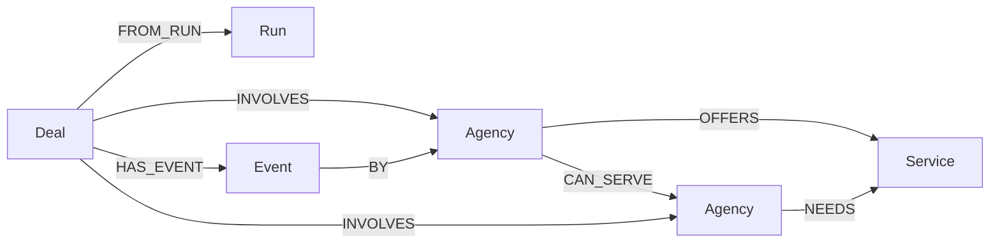

# Deadlock

**A connected deal where a direct swap cannot work.** Built by team **ContextSense** for Graph Hacks.

Deadlock lets fictional creative agencies exchange spare capacity in three- or four-party agreements. One agency's offer meets another's need; FalkorDB finds the cycle that closes the exchange. Autonomous policy representatives negotiate hours under explicit constraints. Humans approve each participant before the complete cycle commits.

Tracks: **Agents That Act on Connected Data** and **Agent Memory and Coordination**.

## Run locally

Requirements: Node.js **22.12 or later** and npm. Native embedded operation supports **macOS Apple Silicon** and **Linux x64**. Other platforms can connect to a Docker/cloud FalkorDB instance. An API key is **not required**.

On macOS, the bundled FalkorDB module links Homebrew's OpenMP and OpenSSL libraries. Install them first if missing: `brew install libomp openssl@3`. `npm run doctor` checks that the engine can actually load and answer a query.

```sh
npm ci
npm run doctor
npm run dev
```

Open **http://127.0.0.1:3000**. The server starts a real local FalkorDB process and seeds six synthetic agencies on first use. Persistent graph files live in `.data/graph`. Stop with Ctrl+C. Start again to resume the same agreements and history.

The root optional dependencies pin the corrected platform binary release. Do not remove them: an older upstream macOS package contains Linux executables. If npm omits optional dependencies, run `npm ci --include=optional`. `npm run doctor` verifies an actual Cypher query against the native engine.

For production serving on your own machine:

```sh
npm run build
npm start
```

The local API binds to `127.0.0.1` by default. This is a single-workspace sandbox with no user authentication. Add authentication and authorization before exposing its mutation routes on a public host.

The embedded data directory is locked against a second application process. After an unclean shutdown, a stale `.data/graph/.deadlock.lock` may remain; remove that file only after confirming no Deadlock process is using the directory. Normal Ctrl+C shutdown releases the lock automatically. Development uses polling so updates also work in cloud-synced folders.

## Try the complete demo

1. Click **Discover exchanges**. Inspect the graph-generated opportunities and open **Graph evidence**.
2. Select the opportunity containing **Motionhaus**, **Wordcraft**, and **Studio North**.
3. Click **Start negotiation**. Open **Agent log** to inspect each representative's checks.
4. Before approving, click **Simulate withdrawal**. Motionhaus becomes unavailable; the old agreement is invalidated and every hold is released.
5. Click **Find another path**, select the **Frame Lab** cycle and negotiate. The agents counter to fit Frame Lab's eight-hour capacity.
6. Approve separately for each member. The final approval commits all capacity in one graph transaction.
7. Download the agreement and evidence. Reload; inspect **Activity**. Restart the server to verify durable memory.

Use **Agencies** to create profiles or change hours, valuations, deadlines and availability. Use **Guide & settings → Reset demo workspace** for a fresh seeded network. Reset affects only the configured Deadlock graph.

## Why FalkorDB is essential

There is no in-memory matching fallback or hardcoded runtime cycle. Typed offers and needs derive directed compatibility edges **inside FalkorDB**. A Cypher variable-length path query discovers closed paths of three or four agencies. The result controls who can negotiate. Graph relationships also retrieve earlier agreements as context for representatives. Profiles, reservations, approvals, events and history persist in FalkorDB.

```cypher
MATCH p=(a:Agency)-[:CAN_SERVE*3..4]->(a)
WHERE all(n IN nodes(p) WHERE n.active = true)
RETURN [n IN nodes(p) | n.id] AS ids LIMIT 2000
```

The coordinator removes repeated participants, deduplicates rotations while preserving direction, and evaluates constraints. Removing FalkorDB stops both discovery and durable operation.

### Graph data model



- **Agency:** offer, need, capacity, held/committed hours, valuation, minimum/requested hours, deadlines, availability and revision.
- **Service:** exact shared taxonomy: design, video, copy, development.
- **Run:** actual discovery query, returned candidates, timestamp and duration.
- **Deal:** immutable participant/terms snapshot, lifecycle status, member approvals and negotiation events.
- **Event:** actor, round, action, explanation and timestamp; connected to its deal and actor.

Readable JSON properties preserve complete snapshots; explicit nodes and relationships power matching, memory and provenance. See [all queries](docs/QUERIES.cypher) and [architecture](docs/ARCHITECTURE.md).

## Agents and agreement guarantees

The default representatives are **deterministic policy agents**, not language models. Each has independent capacity, delivery and value limits. In at most six rounds they inspect, counter, accept or reject an exchange. They never silently relax a member's minimum or deadline. Credits are synthetic comparison units, not currency.

A stable agreement holds capacity and enters `awaiting_approval`. Each participant requires an explicit human sandbox approval. Final approval converts all holds to commitments together. Duplicate approval is idempotent. Cancellation or a profile change releases every affected pending hold. Committed agreements remain historical records; the app does not claim any service was delivered.

Mutations are serialized in **one Node server process**, and each mutation is one atomic Cypher write. The prototype replaces its small graph snapshot per mutation; it is not optimized for an unbounded exchange marketplace. Do not run multiple application processes against the same graph. There is no distributed lock, automatic reservation expiry, real identity verification, escrow or payment system.

### Optional language-model advisor

Copy `.env.example` to `.env` and set `MODEL_API_KEY`, `MODEL_NAME`, and optionally `MODEL_BASE_URL` for a compatible Chat Completions provider. Restart the server. The model receives the synthetic participants and policy outcome and writes a bounded explanation in the log. An eight-second timeout or invalid response falls back visibly to policy-only operation. Keys stay on the server.

**The model does not negotiate terms, approve on behalf of a person, or execute commitments.** This is optional model assistance, not a claim that default negotiations are LLM-generated. No paid model call was necessary for the local verification.

## Docker or an external database

If Docker is running, the complete app and database can be started with:

```sh
docker compose up --build
```

The app is available at http://127.0.0.1:3000. The named `graph-data` volume holds database data. The compose ports bind only to localhost. Do not run the native app on port 3000 at the same time. The Docker path is supplied for portability; this machine's Docker daemon was stopped, so the verified path is native embedded FalkorDB.

For an existing database, set `FALKORDB_URL=redis://127.0.0.1:6379` in `.env`. Use `rediss://` for a TLS endpoint and `FALKORDB_GRAPH` for an isolated graph name. External database persistence is the operator's responsibility. **Use a dedicated graph**: demo reset replaces the selected graph's contents.

## Checks

```sh
npm run typecheck
npm test
npm run build
npm audit
```

Tests start isolated real FalkorDB instances, so optional native binaries are required for the integration suite even when the app uses a remote database. Coverage includes policy counters and deadlines, graph cycle discovery, contention, human approval transitions, invalidation, cancellation, restart persistence, prior-context retrieval, API validation and model-response fallback. Browser checks cover desktop/mobile negotiation, withdrawal, rerouting, approvals, profile editing/creation, and reload. See [browser QA](docs/BROWSER-QA.md) and [progress](docs/PROGRESS.md) for verification records.

## Project documentation

- [Scope and design](docs/superpowers/specs/2026-10-18-deadlock-design.md)
- [Features and acceptance journey](docs/FEATURES.md)
- [Implementation plan](docs/superpowers/plans/2026-10-18-deadlock.md)
- [Architecture and API](docs/ARCHITECTURE.md)
- [Cypher queries](docs/QUERIES.cypher)
- [Demo script](docs/DEMO.md)
- [Submission checklist](docs/SUBMISSION.md)
- [Post-hackathon product hypotheses](docs/PRODUCT.md)

## Data provenance and AI assistance

All agency profiles, relationships, valuations and transactions are authored synthetic fixtures. No private company data, personal records or restricted sources are loaded. The app sends no external messages.

OpenAI Codex assisted with ideation, scope, implementation, documentation and test execution. A separate Codex reviewer checked the design and implementation. The human participant must review, verify and understand the code, graph model, queries and technical decisions before submitting; the project does not claim that review has already happened.

Technical references: [FalkorDB TypeScript client](https://github.com/FalkorDB/falkordb-ts), [FalkorDBLite](https://github.com/FalkorDB/falkordblite-ts), [FalkorDB Cypher](https://docs.falkordb.com/cypher/), [Chat Completions API](https://developers.openai.com/api/reference/resources/chat/subresources/completions/methods/create).
