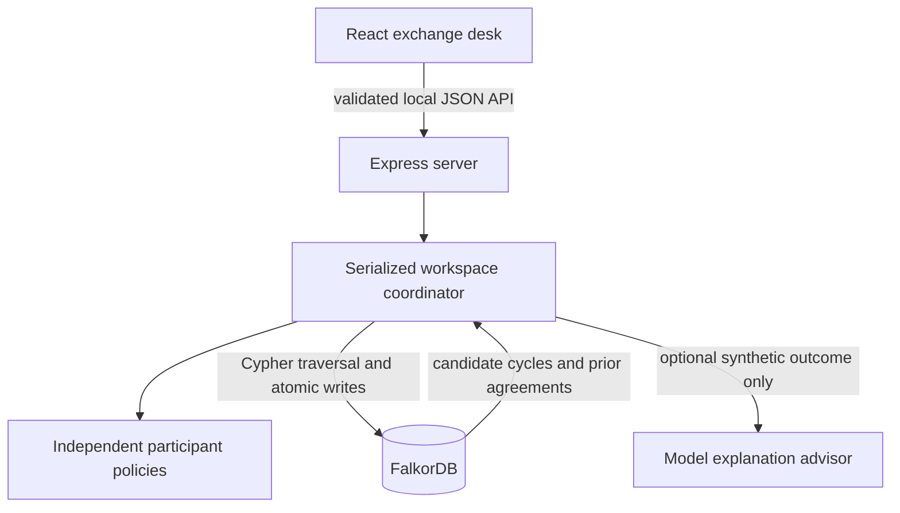
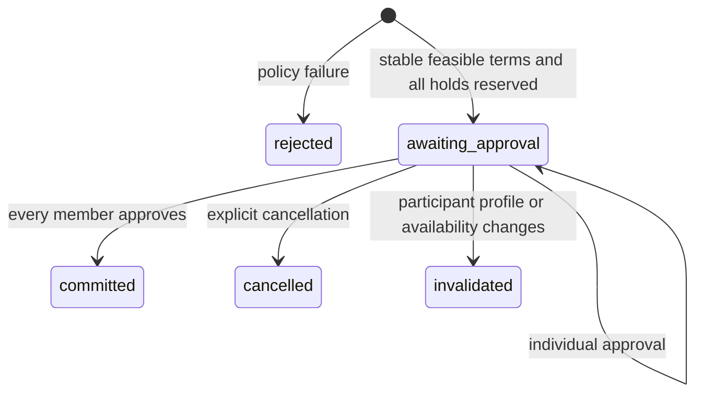

# Deadlock architecture

## Runtime

`src/shared/types.ts` is the API/domain contract. The browser never connects to the database or receives model credentials. Vite is middleware in the same Node process during development. Production serves the Vite build through Express.

## Graph ownership

FalkorDB is the only durable store. Agency profiles and service relationships generate `CAN_SERVE` edges. The database follows directed closed paths of length three or four. The application rejects repeated members, canonicalizes rotations, and ranks feasible paths by aggregate synthetic service credits, breaking ties by stable cycle ID. This ranking does not claim optimal economic utility, service quality, or global optimality.

The traversal is bounded to 2,000 raw paths, so discovery is not exhaustive in a dense large network. Agency creation is capped at 30 profiles. The product and demo are designed for a small community of six agencies.

`Deal-[:INVOLVES]->Agency` retrieves the latest related agreement for each representative. A subsequent negotiation records which previous agreement it consulted, then rechecks current constraints. The shared graph also supplies current reservations and commitments. Historical memory never overrides a current capacity or deadline limit.

The `Agency`, `Run`, `Deal`, and `Event` nodes keep JSON snapshots for complete historical reconstruction. Typed graph relationships power matching and evidence paths. IDs are application-level UUIDs/slugs; internal graph node IDs are not stable.

## Negotiation policy

An ordered cycle's leg `i` is agency `i` providing its service to agency `i+1`, wrapping at the end. Initial requested hours come from the recipient.

For each participant:

1. Incoming service must equal its declared need.
2. Provider delivery time must be at most its receive-by deadline.
3. Incoming hours must meet its minimum.
4. Outgoing hours must fit total capacity minus all held and committed hours.
5. Outgoing credits must not exceed incoming credits multiplied by `1 + maxImbalancePct/100`.

Representatives lower outgoing hours in quarter-hour increments, never below the next recipient's minimum. A stable round accepts the exchange. No stable round within six rounds rejects it. This is a bounded conservative protocol; it can reject an agreement a more sophisticated optimizer might find. Credits compare synthetic effort valuations and are not currency or an independent fairness measure.

## Agreement state machine

The final approval converts every participant's outgoing hold to committed capacity together. Repeated approval or cancellation is idempotent. A changed profile invalidates every related pending deal and releases all their holds. Committed deals preserve their participant snapshot and cannot be cancelled through this sandbox.

There is no automatic reservation expiry. Pending deals stay visible until approved, cancelled, or invalidated. This is deliberate for a short, inspectable hackathon workflow; a real exchange needs expiry, notifications, and reconciliation.

## Atomicity and limits

A promise queue serializes mutations within one server. Each operation loads the current graph, evaluates the transition, then issues a single parameterized Cypher statement to replace the small workspace graph. Approval flags, capacity counters, agreement status and audit events change in that same statement. Reads see the previous or next complete graph state.

This whole-workspace replacement makes the prototype simple to audit. Its write cost grows with history; it is not a production scaling design. A larger product should use targeted transactional updates, revision checks in the database, retention/archival, and a distributed lock or compare-and-swap strategy. Running several app processes on one graph is unsupported.

The embedded engine uses append-only persistence with `appendfsync always`; Redis files remain in `.data/graph`. Its Unix socket lives in the OS temporary directory to avoid macOS socket-path limits in deep workspaces. The app shuts down the client and owned database process on SIGINT/SIGTERM. Remote deployments must configure their own persistence and backup.

## API

| Method | Route | Result |
|---|---|---|
| GET | `/api/health` | Database/agent status; graph read verifies connectivity |
| GET | `/api/state` | Profiles, agreements, discovery runs and mode |
| POST | `/api/discover` | Persisted graph search with candidate cycles |
| POST | `/api/negotiate` | `{runId, agencyIds}` -> negotiated deal and events |
| POST | `/api/deals/:id/approve` | `{agencyId}` -> one sandbox member approval |
| POST | `/api/deals/:id/cancel` | Cancel pending proposal and release holds |
| GET | `/api/deals/:id/export` | JSON terms, events and discovery evidence |
| POST | `/api/agencies` | Validated new profile; server assigns ID/counters |
| PUT | `/api/agencies/:id` | Revision-checked profile edit and invalidation |
| POST | `/api/reset` | Requires `{confirm:true}`; replaces the dedicated graph |

Validation errors return 400; missing resources 404; stale/conflicting actions 409; database failures 503. Mutation input is bounded to 32KB and validated with Zod. Browser cross-origin access is rejected. These are sandbox safeguards, not a substitute for authentication or tenant isolation.

## Optional model advisor

The server sends a synthetic outcome to a configurable Chat Completions endpoint. A strict local schema accepts only a nonempty summary of at most 600 characters. The request times out after eight seconds, invalid provider responses produce a visible fallback event, and no model output changes terms, participant membership, holds, approvals or commitments. There is no claim of LLM-powered negotiation in policy mode.

## Source map

- `src/server/negotiation.ts`: pure participant policies and cycle canonicalization.
- `src/server/graph.ts`: native/remote graph connection and persistence setup.
- `src/server/store.ts`: discovery, memory, agreement transitions and atomic writes.
- `src/server/api.ts`: JSON input validation, same-origin checks and error boundaries.
- `src/server/advisor.ts`: optional bounded model explanation.
- `src/server/seed.ts`: authored synthetic agency data.
- `src/client/App.tsx`: workspace orchestration and API state.
- `src/client/components/`: network, negotiation, directory and history UI.

## Beyond the prototype

Before a public service: authenticated agency identities, isolated tenant graphs, bounded/archived audit logs, stale-reservation expiry, distributed consistency, durable idempotency keys, verified deliverables, privacy controls, accessible high-density network layouts, and a real dispute/fulfillment process.
