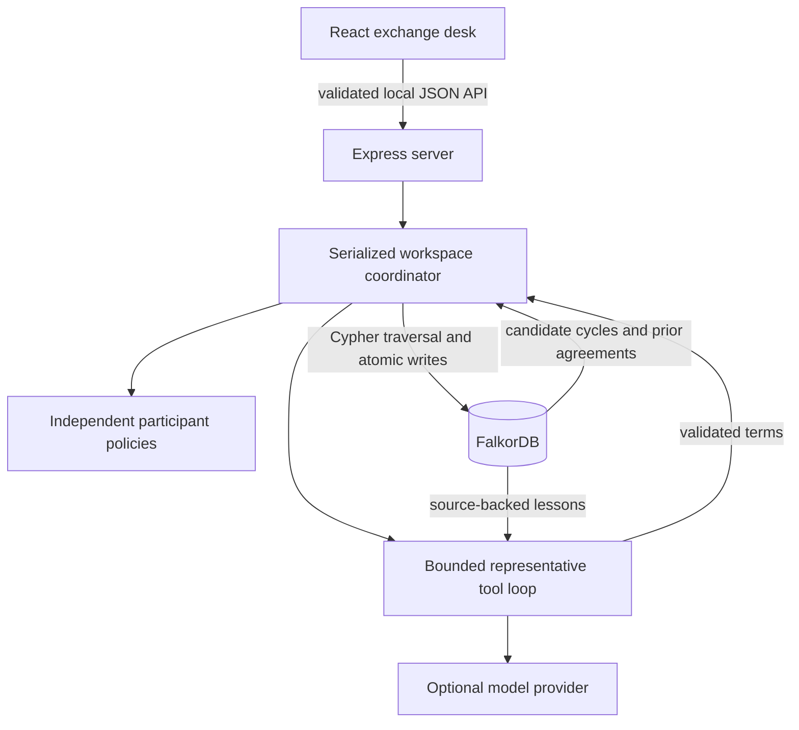
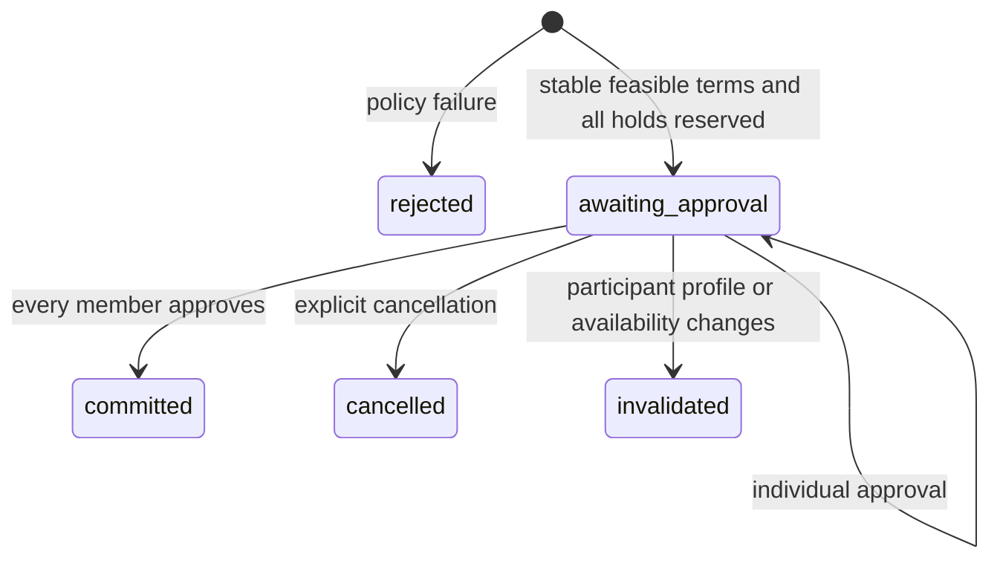

# Deadlock architecture

## Runtime

The frontend has three routes served by one SPA: `/` (landing), `/docs` and `/app` (workspace). Workspace views map to `/app`, `/app/ask`, `/app/agencies`, `/app/activity`, `/app/memory` and `/app/settings`; `?deal=<id>` opens an agreement. `src/client/router.tsx` is a minimal history router; Express and Vercel rewrites serve `index.html` for them. Motion comes from `motion/react` with `MotionConfig reducedMotion="user"`. The network view draws FalkorDB's `CAN_SERVE` edges; selected loops animate with path drawing and SVG `animateMotion` particles.

`src/shared/types.ts` is the API/domain contract. The browser never connects to the database or receives model credentials. Vite is middleware in the same Node process during development. Production serves the Vite build through Express.

## Graph ownership

FalkorDB is the only durable store. Agency profiles and service relationships generate `CAN_SERVE` edges. The database follows directed closed paths of length three or four. The application rejects repeated members, canonicalizes rotations, and ranks feasible paths by aggregate synthetic service credits, breaking ties by stable cycle ID. This ranking does not claim optimal economic utility, service quality, or global optimality.

The traversal is bounded to 2,000 raw paths, so discovery is not exhaustive in a dense large network. Agency creation is capped at 30 profiles. The product and demo are designed for a small community of six or ten seeded agencies.

`Deal-[:INVOLVES]->Agency` retrieves the latest related agreement for each representative. A subsequent negotiation records which previous agreement it consulted, then rechecks current constraints. The shared graph also supplies current reservations and commitments. Historical memory never overrides a current capacity or deadline limit.

The `Workspace`, `Agency`, `Run`, `Deal`, `Lesson`, and `Event` nodes keep JSON snapshots for complete historical reconstruction. Typed graph relationships power matching and evidence paths. IDs are application-level UUIDs/slugs; internal graph node IDs are not stable.

`Workspace` metadata records sample/custom origin and selected scenario. Initialization checks for Agency or Workspace nodes, so an intentionally empty custom workspace is preserved across restarts. New empty workspaces use the same create/edit, traversal, negotiation and approval routes as samples. This remains a single locally operated workspace; custom entry does not imply real identity verification.

## Negotiation policy

An ordered cycle's leg `i` is agency `i` providing its service to agency `i+1`, wrapping at the end. Initial requested hours come from the recipient.

For each participant:

1. Incoming service must equal its declared need.
2. Provider delivery time must be at most its receive-by deadline.
3. Incoming hours must meet its minimum.
4. Outgoing hours must fit total capacity minus all held and committed hours.
5. Outgoing credits must not exceed incoming credits multiplied by `1 + maxImbalancePct/100`.

Representatives lower outgoing hours in quarter-hour increments, never below the next recipient's minimum. A stable round accepts the exchange. No stable round within six rounds rejects it. This is a bounded conservative protocol; it can reject an agreement a more sophisticated optimizer might find. Credits compare synthetic effort valuations and are not currency or an independent fairness measure.

## Agreement state machine

The final approval converts every participant's outgoing hold to committed capacity together. Repeated approval or cancellation is idempotent. A changed profile invalidates every related pending deal and releases all their holds. Committed deals preserve their participant snapshot and cannot be cancelled through this sandbox.

There is no automatic reservation expiry. Pending deals stay visible until approved, cancelled, or invalidated. This is deliberate for a short, inspectable hackathon workflow; a real exchange needs expiry, notifications, and reconciliation.

## Atomicity and limits

A promise queue serializes mutations within one server. Each operation loads the current graph, evaluates the transition, then issues a single parameterized Cypher statement to replace the small workspace graph. Approval flags, capacity counters, agreement status and audit events change in that same statement. Reads see the previous or next complete graph state.

This whole-workspace replacement makes the prototype simple to audit. Its write cost grows with history; it is not a production scaling design. Writes carry a graph-side revision check: the statement begins with `MATCH (w:Workspace) WHERE coalesce(w.revision,0) = $expected`, and every later clause is grouped by that revision, so a stale writer changes nothing. The store then confirms its own `writeId` on the Workspace node and otherwise raises a 409 conflict. Several app instances (for example serverless replicas) can therefore share one graph safely. A larger product should still move to targeted transactional updates and retention/archival.

The embedded engine uses append-only persistence with `appendfsync always`; Redis files remain in `.data/graph`. Its Unix socket lives in the OS temporary directory to avoid macOS socket-path limits in deep workspaces. The app shuts down the client and owned database process on SIGINT/SIGTERM. Remote deployments must configure their own persistence and backup.

## API

| Method | Route | Result |
|---|---|---|
| GET | `/api/health` | Database/agent status; graph read verifies connectivity |
| GET | `/api/state` | Profiles, `CAN_SERVE` edges read from FalkorDB (drawn by the network view), agreements, runs, mode |
| POST | `/api/discover` | Persisted graph search with candidate cycles |
| POST | `/api/negotiate/stream` | Same body; NDJSON lines `{type:'event'}` per decision, then `{type:'deal'}` or `{type:'error'}` |
| POST | `/api/negotiate` | `{runId, agencyIds, mode?, useMemory?}` -> negotiated deal and events |
| POST | `/api/deals/:id/lessons` | `{agencyId, preferredHours}` -> source-backed participant feedback |
| POST | `/api/deals/:id/approve` | `{agencyId}` -> one sandbox member approval |
| POST | `/api/deals/:id/cancel` | Cancel pending proposal and release holds |
| GET | `/api/deals/:id/export` | JSON terms, events and discovery evidence |
| POST | `/api/agencies` | Validated new profile; server assigns ID/counters |
| PUT | `/api/agencies/:id` | Revision-checked profile edit and invalidation |
| POST | `/api/reset` | Requires `{confirm:true, scenario?:"starter"\|"launch"\|"empty"}` and, when `ACCESS_KEY` is set, header `x-access-key`; replaces the dedicated graph |

Validation errors return 400; missing resources 404; stale/conflicting actions 409; database failures 503. Mutation input is bounded to 32KB and validated with Zod. Browser cross-origin access is rejected. These are sandbox safeguards, not a substitute for authentication or tenant isolation.

## Model decisions and learned preferences

`buildProposals` generates requested, lean and optionally remembered scope vectors. The pure policy engine finds feasible terms; `validateLegs` independently rechecks the original participants' complete hard constraints. The model sees only this feasible menu. It must inspect context before deciding. A counter changes the actual eventual reservation vector and restarts representative acceptance; a human approval is a separate lifecycle action.

Model transport uses Chat Completions function calls, strict local Zod argument validation, one tool call per response, three tool requests per representative turn, twelve seconds per provider request, six negotiation rounds and sixty seconds total. Errors and repeated/unknown proposals reject without new holds. The requested model, provider-reported actual models, identity-availability flag, mode, memory flag, lesson IDs, selected proposal and actual tools persist with the deal. Key-free policy simulation remains explicit. Preflight-infeasible paths reject before calling the provider.

A lesson is human-entered participant feedback about preferred received scope. `Lesson-[:ABOUT]->Agency` and `Lesson-[:LEARNED_FROM]->Deal` preserve its provenance. Source negotiations must involve the agency. Recording a lesson supersedes its previous active lesson without changing hard profiles. Active lessons are retrieved through the graph when memory is enabled. The participant's representative receives only its own lesson records; remembered proposal vectors can reflect the whole cycle's preferences. Infeasible feedback is retained but cannot override hard minimums.

The Memory UI compares persisted outcomes only when ordered cycle, actual execution mode known model identity/provider for model runs, and full participant snapshots (including capacity counters and revisions) are identical. It never invents an improvement estimate. Integration tests close and reopen real FalkorDB between learning and negotiation, then disable memory to restore the baseline terms.

## Source map

- `src/server/negotiation.ts`: pure participant policies and cycle canonicalization.
- `src/server/graph.ts`: native/remote graph connection and persistence setup.
- `src/server/store.ts`: discovery, memory, agreement transitions and atomic writes.
- `src/server/api.ts`: JSON input validation, same-origin checks and error boundaries.
- `src/server/model.ts`: Chat Completions-compatible inspection and decision tools.
- `src/index.ts`: Vercel entrypoint (remote FalkorDB).
- `src/server/agents.ts`: feasible proposal menu and bounded coordination.
- `src/server/showcase.ts`: heterogeneous ten-agency challenge.
- `src/server/seed.ts`: authored synthetic agency data.
- `src/client/App.tsx`: workspace orchestration and API state.
- `src/client/site/`: landing and docs pages.
- `src/client/components/StatsRow.tsx`: animated network-health tiles.
- `src/server/tools.ts`, `src/server/ask.ts`, `src/mcp.ts`: graph tools, the Ask agent and the MCP server.
- `src/client/components/`: network, negotiation, directory and history UI.

## Beyond the prototype

Before a public service: authenticated agency identities, isolated tenant graphs, bounded/archived audit logs, stale-reservation expiry, distributed consistency, durable idempotency keys, verified deliverables, privacy controls, accessible high-density network layouts, and a real dispute/fulfillment process.
